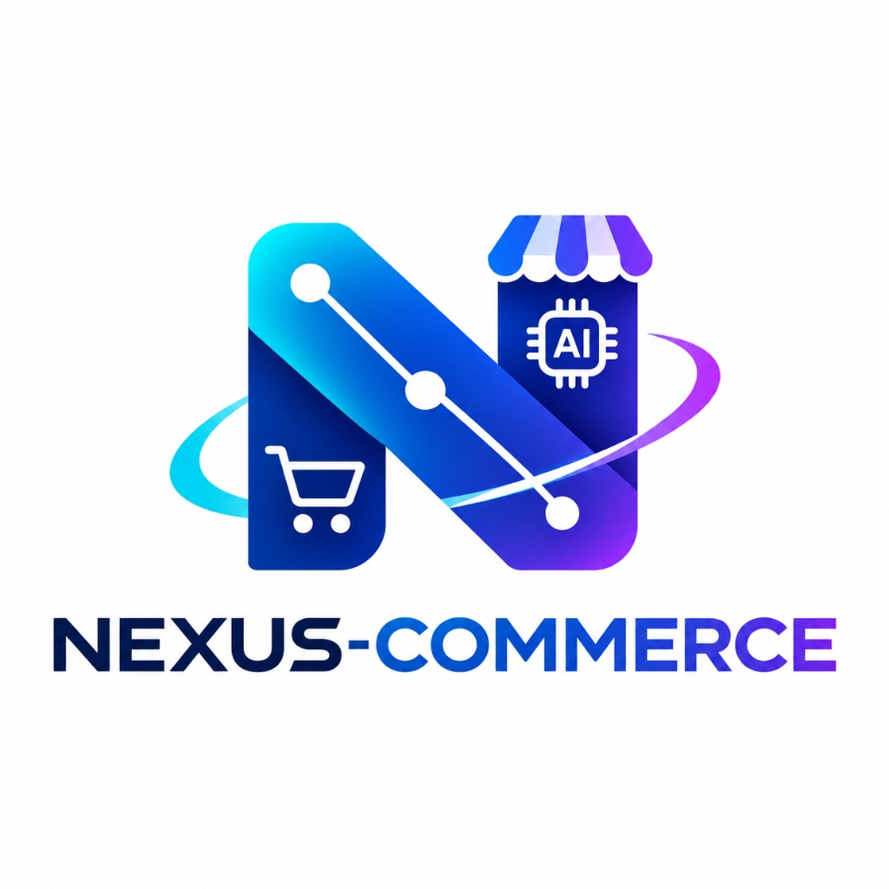

<p align="center">
  
</p>

# NEXUS-COMMERCE — Full-Stack E-Commerce & Mini CRM

> **NEXUS-COMMERCE** is a modern, responsive full-stack e-commerce web application with an integrated merchant CRM dashboard, built with Next.js (App Router), TypeScript, Tailwind CSS, and local persistence.

---

## 🎯 Project Overview
- **Community:** Google Developer Groups on Campus (GDGoC), CUI Wah
- **Bootcamp:** Beyond Prompting — Building the AI Future (Capstone Assignment 2026)
- **Developer:** [hamzaali-712](https://github.com/hamzaali-712)
- **Development Approach:** Prompt Engineering + Context Engineering + Full-Stack Architecture

---

## 🚀 Key Features

### 🛒 1. Customer-Facing Storefront
- **Modern Homepage:** Hero banner, value propositions, category navigation, and featured products.
- **Product Catalog:** Real-time search by keyword, category filtering, and sorting (price, name).
- **Product Detail View:** Image, stock availability badge, item description, and cart actions.
- **Interactive Cart:** Slide-over/dedicated cart with quantity controls, item removal, and subtotal calculation.
- **Simulated Checkout:** Multi-step customer checkout without real money/card processing. Creates confirmed orders immediately.

### 📊 2. Merchant Mini CRM & Admin Dashboard
- **Admin Metrics:** Real-time business overview (Total Revenue, Active Orders, Low Stock Alerts, Total Customers).
- **Order Management:** View incoming orders, view items purchased, update status (Pending, Processing, Shipped, Completed, Cancelled).
- **Inventory & Product Management:** Add new products, update prices/stock, and delete discontinued items.
- **Customer Directory:** Track customer purchase history and contact inquiries.

---

## 🛠️ Technology Stack
- **Framework:** Next.js (App Router)
- **Language:** TypeScript
- **Styling:** Tailwind CSS (v4)
- **Icons:** Lucide React
- **Local Database / State:** Typed JSON / SQLite with local persistence
- **Version Control:** Git

---

## 💻 Local Setup & Running

1. **Install dependencies:**
   ```bash
   npm install
   ```

2. **Run development server:**
   ```bash
   npm run dev
   ```

3. **Open in browser:**
   Open [http://localhost:3000](http://localhost:3000) to view the storefront.
   Access `/admin` for the merchant CRM dashboard.

---

## 📝 Prompt Engineering Documentation
Documented prompts, context engineering logs, and verification reports are stored inside the [`prompts/`](prompts/) folder according to the bootcamp rubric.
