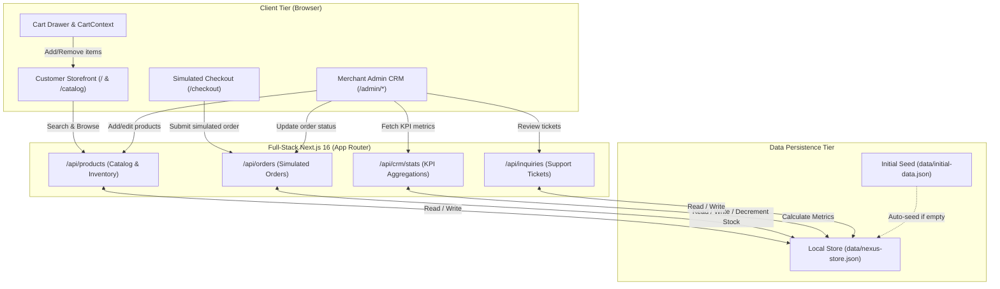

# NEXUS-COMMERCE — System Architecture

This document outlines the architecture, data flow, and component relationships of the NEXUS-COMMERCE platform built for the **Beyond Prompting Bootcamp 2026 (GDGoC CUI Wah)**.

---

## 🏛️ High-Level Architecture Diagram

---

## 🔄 Core User & Data Flows

### 1. Storefront Discovery to Cart
1. The customer loads `/catalog`.
2. Products are rendered from `data/nexus-store.json`.
3. Shoppers filter by department (`Audio`, `Wearables`, `Accessories`, `Electronics`) or search titles and descriptions in real time.
4. Clicking **"Add to Cart"** updates `CartContext`, stores the cart state in `localStorage`, and opens `CartDrawer.tsx`.

### 2. Simulated Checkout to CRM Sync
1. The buyer clicks **"Proceed to Simulated Checkout"** (`/checkout`).
2. The user completes the shipping form (Name, Address, City) and chooses a simulated payment method.
3. The checkout form submits a `POST` request to `/api/orders`.
4. In `src/lib/store.ts`:
   - An order ID (`ORD-XXXX`) is assigned.
   - Catalog stock for each ordered item is decremented.
   - The customer profile is created or updated in the customer directory.
   - The order is saved to `data/nexus-store.json`.
5. The buyer receives an immediate **Order Confirmation Receipt**.
6. The merchant instantly sees the new order under `/admin/orders` with status `Pending`.

### 3. Merchant Order Fulfillment
1. The merchant navigates to `/admin/orders`.
2. They select a new status from the dropdown (e.g., changes `Pending` to `Shipped` or `Delivered`).
3. An asynchronous `PATCH` request is dispatched to `/api/orders/[id]`.
4. The status updates in `data/nexus-store.json` and the UI updates the color-coded status badge in real time.
